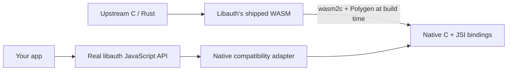

# Libauth for React Native

[](https://github.com/salemkode/react-native-libauth/actions/workflows/checks.yml)

**Use the real `@bitauth/libauth` in a React Native app.** A small adapter compiles
its C/Rust-derived crypto to native C/JSI and connects it to the installed library.
Your functions and TypeScript types still come from libauth.

```js
import { initializeLibauth } from 'react-native-libauth';
import { sha256, utf8ToBin, binToHex } from '@bitauth/libauth';

export async function hashMessage(message) {
  await initializeLibauth(); // shared, one-time initialization
  return binToHex(sha256.hash(utf8ToBin(message)));
}
```

No copied libauth distribution. No alternative crypto API. The example app is a
test bench, not something consumers need to install.

**Start here:** [run the example](#run-the-example) · [use in your app](docs/integration.md)
· [contribute](CONTRIBUTING.md) · [agent instructions](AGENTS.md)

## What is supported?

| Component | Supported / tested version |
| --- | --- |
| Libauth | `@bitauth/libauth` **3.0.0** |
| React Native | **0.81.x**, tested with **0.81.5** and React **19.1.0** |
| Architecture / engine | New Architecture / Hermes |
| Native backend | Polygen **0.2.1**, with the included compatibility patch |
| Converter | WABT / wasm2c **1.0.36**, installed locally by the setup command |
| JavaScript tooling | Node **22+**, npm; lockfile included |
| Platforms | iOS simulator and Android native builds |

This is an **experimental compatibility adapter**. Other React Native/libauth
versions need testing. It is not a general C/Rust converter or a security audit.
Native code requires a development/custom build; **Expo Go cannot load it**.

## Run the example

You need access to this private repository. Authenticate with GitHub before cloning.
For iOS, install Xcode and CocoaPods. For Android, use JDK 17, the Android SDK, and
the NDK version configured by the example.

```sh
gh repo clone salemkode/react-native-libauth
cd react-native-libauth
npm ci
npm run setup:toolchain
npm run generate
npm test
npm run typecheck
npm run lint
```

`npm ci` reapplies the dependency/JavaScript patches. The toolchain command installs
checksum-verified WABT into `.tools/`; it does not replace your global tools.
On Linux x64 it builds wasm2c from pinned source; install CMake, a C++ compiler,
and OpenSSL development headers first (`cmake g++ libssl-dev` on Ubuntu).
Generation creates the native C/JSI sources needed by the platform build.

### iOS

```sh
cd example/ios
pod install
cd ../..
npm start
```

In another terminal at the repository root:

```sh
npm run ios -- --udid YOUR_SIMULATOR_UDID
```

Use the UDID of a simulator you selected. You can also build the `LibauthLab` scheme
from `example/ios/LibauthLab.xcworkspace` in Xcode.

### Android

Set `JAVA_HOME` to JDK 17 and `ANDROID_HOME` to your SDK directory. Start an emulator,
then run from the repository root:

```sh
npm start
# In another terminal:
npm run android -- --deviceId YOUR_DEVICE_SERIAL
```

The example uses Metro on **8097** for both platforms. If Android cannot reach it:

```sh
adb -s YOUR_DEVICE_SERIAL reverse tcp:8097 tcp:8097
```

Open **LibauthLab** and tap **Run native tests**. All 12 checks should pass. There is
also a SHA-256 input field. The app uses fixed test keys, not a real wallet.

## Use it in your own app

The adapter is **not published to npm**. Build a tarball from this repository, then
install it into your existing React Native 0.81 app:

```sh
# In this repository, after generation:
mkdir -p artifacts
npm pack --workspace packages/react-native-libauth --pack-destination artifacts

# In your app (replace the tarball path):
npm install /absolute/path/react-native-libauth-0.1.0.tgz \
  @bitauth/libauth@3.0.0 @callstack/polygen@0.2.1 \
  react-native-get-random-values@1.11.0
npx libauth-native --setup
npx libauth-native
```

Run `pod install` in the consuming app's iOS folder, then build normally. Add
`libauth-native --js-only` to its `postinstall`, keeping any existing commands.
Run the full native generation command after reinstalling dependencies and before
a native build.

The [integration guide](docs/integration.md) covers startup, postinstall, CI,
autolinking, troubleshooting, and removing the adapter. Installing this monorepo's
Git URL directly is not the adapter installation method.

## How it works



The build uses libauth's original WASM files, removes non-executable custom
metadata for WABT compatibility, and generates native code. A manifest records
both original and processed hashes. **Original `.wasm` files stay unchanged.**

Small patches to the installed libauth package replace top-level-await crypto
initialization and select a React Native entry that loads the required setup.
Polygen's compatibility changes are kept as a roughly 21 KB `patch-package` patch
against its npm release, rather than a vendored runtime tree.

The [architecture notes](docs/architecture.md) list the exact dependency mutations,
native fixes, and constraints. The adapter also changes initialization in the
installed Node copy of libauth; Node tools sharing that dependency must call its
explicit initializer, as this repository's tests and fixture tool do.

## Verification

```sh
npm test                 # crypto vectors, API surface, binary and adapter contracts
npm run typecheck        # consumer-facing TypeScript API
npm run lint             # example app lint checks
npm run test:consumer    # pack, install into a separate app, regenerate, verify
```

The isolated consumer test verifies a real tarball install, CLI help/error behavior,
repeatable generation, unchanged original WASM, all five native modules, and the
12 crypto checks in Node. It does not claim to execute JSI.

The device app verifies native execution: SHA-1/SHA-256/SHA-512/RIPEMD-160,
streaming and padding boundaries, repeated ECDSA and BCH Schnorr signing,
verification and tampered messages, invalid keys, secure randomness, CashAddress,
and BIP32 derivation. BCH Schnorr is distinct from BIP340.

| Check | Local evidence |
| --- | --- |
| Automated suite | 23 tests passing |
| Consumer declarations | TypeScript passing |
| iOS and Android arm64 | Native builds passing |
| iOS simulator | 12 native checks passing; recorded flow replay passing |
| Android device/emulator | Runtime validation not yet performed |

To replay the native check with Argent 0.32:

```sh
argent e2e run libauth-native-suite --platform ios --device YOUR_SIMULATOR_UDID
```

See [testing instructions](docs/testing.md) for builds, evidence, and the distinction
between Node WASM tests and native C/JSI tests.

## Repository layout

```text
packages/react-native-libauth/   Reusable adapter, CLI, native integration, patch
example/                       Optional React Native test app
shared/                        Fixed reference vectors and common checks
tests/                         Node regression tests
scripts/                       Workspace helpers and isolated consumer test
docs/                          Integration, architecture, and testing guides
.argent/e2e/                   Recorded native verification
```

## License

New adapter code is [MIT](LICENSE). Libauth, Polygen, WABT, and the other dependencies
retain their upstream licenses and notices. Access to this repository is private;
collaborators need an invitation.
